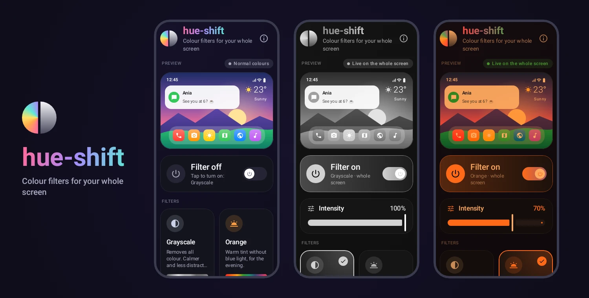
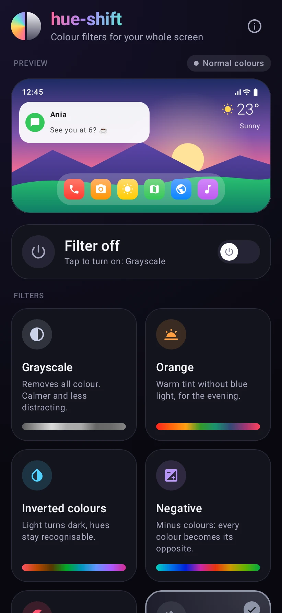
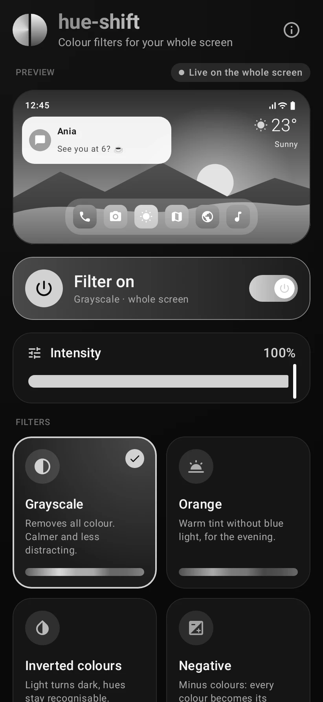
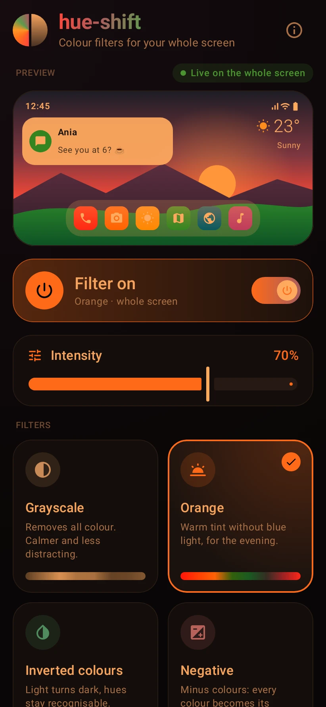
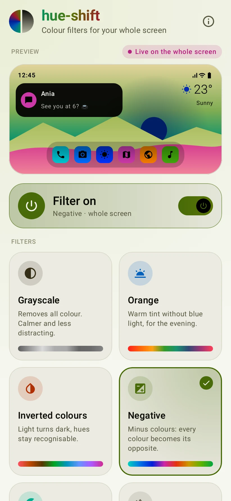
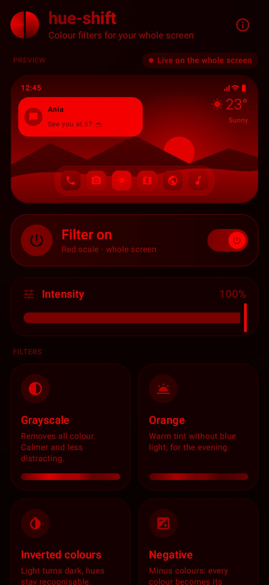
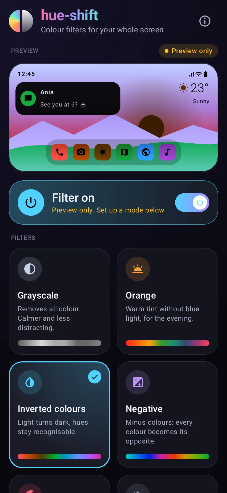
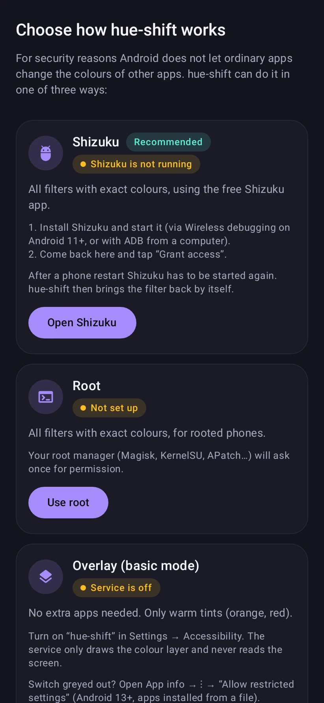

<p align="center">
  
</p>

<p align="center">
  <a href="README.md">🇵🇱 Polski</a> &nbsp;·&nbsp; <b>🇬🇧 English</b>
</p>

<p align="center">
  <a href="https://github.com/vSake-clean/hue-shift/actions/workflows/build.yml"></a>
  
  
  <a href="LICENSE"></a>
</p>

**hue-shift** is an open-source Android app that changes the colours of your **whole screen**: every app, the status bar and the notifications. Pick a filter, for example grayscale, and the entire phone turns gray right away. One switch brings the normal colours back.

## Contents

- [Features](#features)
- [Screenshots](#screenshots)
- [Filters](#filters)
- [How does it work?](#how-does-it-work)
- [Installation](#installation)
- [Setup (one time)](#setup-one-time)
- [Usage](#usage)
- [FAQ and limitations](#faq-and-limitations)
- [Building from source](#building-from-source)
- [Adding a new filter](#adding-a-new-filter)
- [Project structure](#project-structure)
- [Privacy](#privacy)
- [License](#license)

## Features

- 🎨 **6 filters:** grayscale, orange, inverted colours, negative ("minus colours"), red scale and off.
- 🎚️ **Adjustable intensity** where it makes sense (grayscale, orange, red scale).
- 👀 **Live preview** at the top: see right away how your phone is going to look.
- ✨ **Smooth animations**, even when the colours of the whole screen change.
- ⚡ **Quick toggles without opening the app:** a Quick Settings tile, a home screen widget and a launcher shortcut.
- 💾 **Remembers** the last filter and its intensity, and brings the filter back after a reboot.
- 🌙 **Dark, modern design** (Material 3, Jetpack Compose) with big, readable cards.
- 🔒 **No ads, no tracking, no internet access.**
- 🌍 Polish and English.
- 🧩 **New filters are easy to add**: one entry in the code.

## Screenshots

<table>
  <tr>
    <td align="center"><br><sub>Main screen</sub></td>
    <td align="center"><br><sub>Grayscale</sub></td>
    <td align="center"><br><sub>Orange, 70%</sub></td>
    <td align="center"><br><sub>Negative</sub></td>
  </tr>
  <tr>
    <td align="center"><br><sub>Red scale</sub></td>
    <td align="center"><br><sub>Preview before setup</sub></td>
    <td align="center"><br><sub>Choosing a mode</sub></td>
    <td></td>
  </tr>
</table>

Screenshots with a filter on show the screen the way you see it on the phone: the filter covers the whole picture, including the app itself.

## Filters

| Filter | What it does | Intensity | Basic mode |
|---|---|:---:|:---:|
| **Grayscale** | Removes all colour and keeps only brightness. The phone becomes less attention-grabbing. | ✅ | – |
| **Orange** | Warm tint without blue light, for the evening. | ✅ | ✅ |
| **Inverted colours** | Inverts brightness (a light background turns dark) but keeps hues, like Android's built-in "Colour inversion". | – | – |
| **Negative** | Minus colours: every colour turns into its opposite, like a photo negative (red → cyan). | – | – |
| **Red scale** | Like grayscale, but in shades of red. Does not dazzle at night. | ✅ | ≈ |
| **Off** | Back to normal colours. | – | – |

✅ supported, ≈ approximation (see [modes](#how-does-it-work)).

## How does it work?

For security reasons Android does not let ordinary apps change the colours of other apps. hue-shift uses the same mechanism as the system's Night Light and grayscale mode: the **colour matrix of SurfaceFlinger**, the process that composes the picture shown on the screen. The matrix is applied to the whole picture at once, so the filter covers every app, the status bar, the notifications and the keyboard. Only privileged processes may change it, which is why hue-shift needs one of these modes:

| Mode | Requires | Filters | Notes |
|---|---|---|---|
| **Shizuku** (recommended) | the free [Shizuku](https://shizuku.rikka.app/) app | all, exact colours | after a reboot Shizuku has to be started again |
| **Root** | Magisk, KernelSU, APatch… | all, exact colours | the filter comes back by itself after every reboot |
| **System features** | a one-time permission through Shizuku or ADB | grayscale, inverted colours | Android's built-in features; afterwards works without Shizuku, also after a reboot |
| **Overlay** (basic mode) | enabling an accessibility service | orange, red (≈) | no extra apps, but it can only tint the screen |

hue-shift picks the best mode that is ready; you can choose another one in the mode settings. Before any mode is set up, the filters work in the preview, so you can try them out first.

## Installation

1. Download the APK from the [Releases](https://github.com/vSake-clean/hue-shift/releases) page (or the latest build from [Actions](https://github.com/vSake-clean/hue-shift/actions/workflows/build.yml), artifact `hue-shift-debug-apk`).
2. Open it on your phone and allow installing from that source.

Android 8.0 or newer is required. You can also [build the app yourself](#building-from-source).

## Setup (one time)

In the app, scroll down to **How it works** and tap **Set up**.

### Shizuku mode (recommended)

[Shizuku](https://shizuku.rikka.app/) lets apps use ADB permissions without root.

1. Install Shizuku from [Google Play](https://play.google.com/store/apps/details?id=moe.shizuku.privileged.api) or [GitHub](https://github.com/RikkaApps/Shizuku/releases) (the **Get Shizuku** button in hue-shift).
2. Start the Shizuku service in one of these ways:
   - **Android 11 and newer, no computer:** enable Developer options (Settings → About phone → tap "Build number" 7 times), then in Shizuku choose to start via **Wireless debugging** and pair the device with the code, following the steps in the app.
   - **With a computer:** enable USB debugging, connect the phone and run the `adb` command that Shizuku shows in its "start via ADB" section.
   - **With root:** in Shizuku choose to start with root.
3. Go back to hue-shift, tap **Grant access** and accept Shizuku's dialog.

Done. After a reboot (without root) Shizuku has to be started again; hue-shift then restores the last filter by itself.

### System features mode

This mode switches Android's built-in grayscale and colour inversion. It helps on phones where the system does not let Shizuku change the colour matrix (e.g. Xiaomi with HyperOS), and when you do not want to start Shizuku after every reboot.

1. Start Shizuku and grant hue-shift access, as in Shizuku mode.
2. In hue-shift tap **Grant with Shizuku** on the **System features** card. Or run this on a computer:
   ```
   adb shell pm grant io.github.vsakeclean.hueshift android.permission.WRITE_SECURE_SETTINGS
   ```

The permission stays. From then on grayscale and inverted colours work without Shizuku, and the system keeps them after a reboot. The intensity cannot be adjusted in this mode.

### Root mode

Tap **Use root** and confirm your root manager's prompt. The filter is restored automatically after every reboot.

### Overlay mode (basic)

1. Tap **Open accessibility settings** and turn on the **hue-shift (basic mode)** service.
2. If the switch is greyed out (Android 13 and newer, apps installed from an APK file), open **App info** → ⋮ menu → **Allow restricted settings** and try again.

The service only draws a translucent colour layer over the screen. It does not read screen content, does not observe your actions and collects no data. This mode can only tint the screen, so it supports just the orange and red filters (the latter as an approximation).

## Usage

- **Tap a filter card**: the whole screen smoothly changes colour and the preview at the top shows the result.
- **The "Intensity" slider** appears for filters where it makes sense.
- **The big switch** turns the last chosen filter on or off. The **Off** card brings back normal colours.
- The chosen filter and intensity are remembered.

### Quick toggles without opening the app

- **Quick Settings tile:** pull down Quick Settings, tap ✏️ (edit) and drag the **hue-shift** tile into the list. A tap turns the filter on or off, a long press opens the app.
- **Widget:** long-press an empty spot on the home screen → Widgets → **hue-shift switch**.
- **Shortcut:** long-press the app icon and choose **Toggle filter** (the shortcut appears after the app has been opened once).

## FAQ and limitations

**Is it safe?**
Yes. hue-shift only changes the colour matrix, which is exactly what Android does for Night Light. Turning the filter off or restarting the phone brings back normal colours. The app has no internet permission.

**Night Light, colour inversion and colour correction**
These system features use the same colour matrix. While a hue-shift filter is on, it takes priority, and hue-shift puts it back if the system overrides it. If Night Light does not come back after you turn the filter off, switch Night Light off and on again.

**Screenshots**
In Shizuku and root mode screenshots do not include the filter (just like with Night Light). In overlay mode they do.

**Reboots**
The colour matrix is cleared on every reboot. With root hue-shift restores the filter right away; in Shizuku mode as soon as Shizuku is started again.

**Performance and battery**
On most phones the colour matrix is applied by the display hardware, so the filter has practically no effect on battery life. On devices without that support the system composes the picture on the GPU, which may use a bit more power.

**Xiaomi, Redmi, POCO (HyperOS / MIUI)**
In Developer options also turn on **USB debugging (Security settings)**. Without it Shizuku says that ADB permissions are limited and cannot grant access. On some HyperOS phones the system still does not let Shizuku change the colour matrix (error details: "Operation not permitted"). Then use the [System features mode](#system-features-mode) for grayscale and inverted colours and the overlay for orange and red. The negative filter is not available in that case.

**It does not work on my phone**
Some manufacturers change how the picture is drawn. If the filter does not show up, please [open an issue](https://github.com/vSake-clean/hue-shift/issues) with your phone model, Android version and the mode you use.

## Building from source

Requirements: JDK 17 or newer and the Android SDK with platform 36 (easiest through Android Studio).

```bash
git clone https://github.com/vSake-clean/hue-shift.git
cd hue-shift
./gradlew assembleDebug        # APK: app/build/outputs/apk/debug/
./gradlew testDebugUnitTest    # unit tests
```

`./gradlew assembleRelease` builds the release version. To sign it with your own key, set the environment variables `HUESHIFT_KEYSTORE_PATH`, `HUESHIFT_KEYSTORE_PASSWORD`, `HUESHIFT_KEY_ALIAS` and `HUESHIFT_KEY_PASSWORD`; without them the APK is signed with the debug key. The **Release** workflow publishes a new version with the APK on the Releases page: push a tag such as `v1.0.0`, or run it by hand (Actions → Release → Run workflow) and enter the version. The workflow uses your key if you add the same values as repository secrets (the keystore itself as `HUESHIFT_KEYSTORE_BASE64`).

The images in this file are generated by a test: `./gradlew testDebugUnitTest -Phueshift.screenshots`.

## Adding a new filter

Every filter is a single definition in [`Filters.kt`](app/src/main/java/io/github/vsakeclean/hueshift/filter/Filters.kt): a colour matrix that depends on the intensity and, optionally, an approximation for the overlay mode. Example, sepia:

```kotlin
val Sepia = HueFilter(
    id = "sepia",
    title = R.string.filter_sepia,
    description = R.string.filter_sepia_description,
    icon = { Icons.Rounded.Photo },
    accent = 0xFFC8A27A,
    supportsIntensity = true,
    transform = { t -> ColorTransform.Identity.lerp(ColorTransform.luminance(1.07f, 0.74f, 0.43f), t) },
)
```

Then add `Sepia` to the `Filters.all` list and the strings `filter_sepia` and `filter_sepia_description` to `values/strings.xml` and `values-pl/strings.xml`. The card, the preview, the intensity slider, the tile and the widget work right away. The same matrix drives both the preview and the system-wide filter, so they always look the same.

## Project structure

```
app/src/main/java/io/github/vsakeclean/hueshift/
├── filter/     # colour maths and filter definitions
├── engine/     # Shizuku, root and overlay modes: ways to change the screen colours
├── core/       # FilterController: state, mode selection and smooth transitions
├── settings/   # settings storage (DataStore)
├── quick/      # tile, widget, shortcut and restoring after a reboot
└── ui/         # Jetpack Compose user interface
```

Bug reports, ideas and pull requests are welcome.

## Privacy

hue-shift has no internet permission, collects no data and contains no ads or analytics libraries. Settings are stored only on your phone.

## License

The project is released under the [MIT](LICENSE) license.
