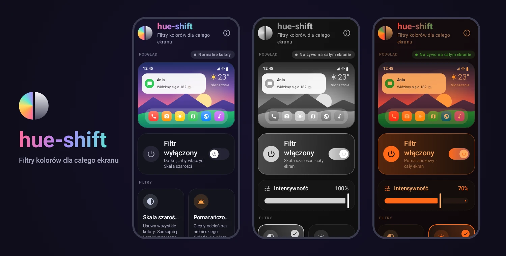
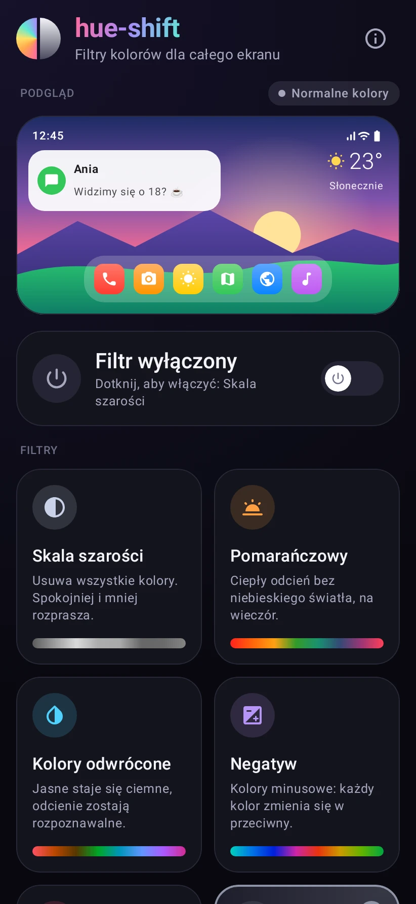
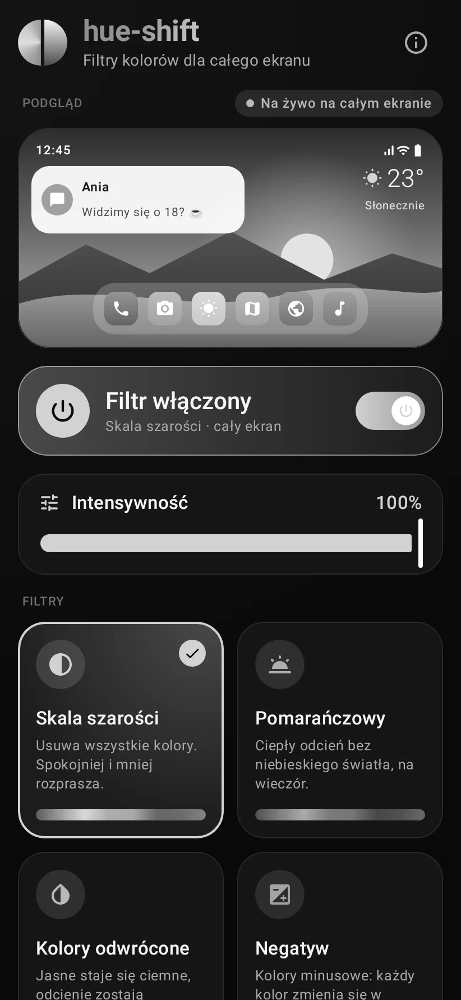
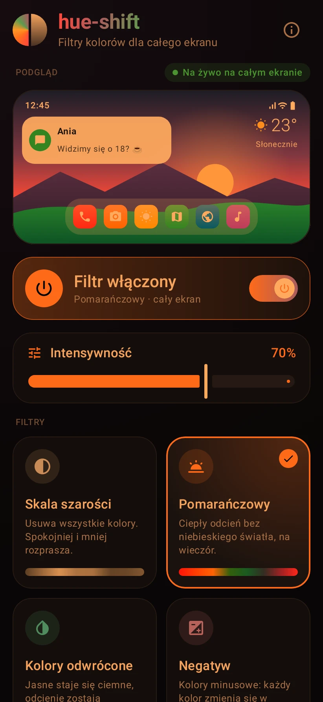
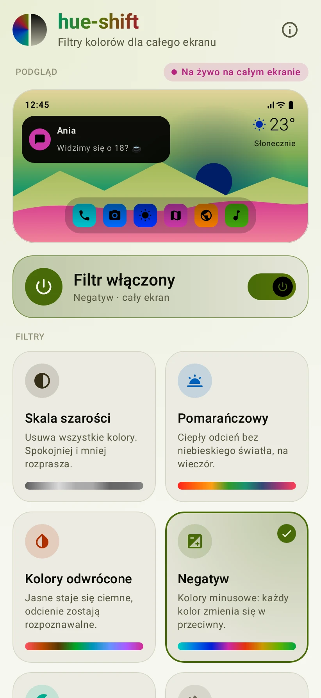
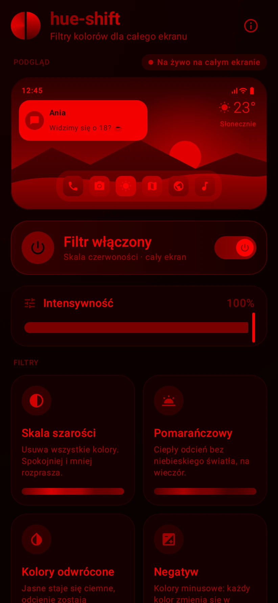
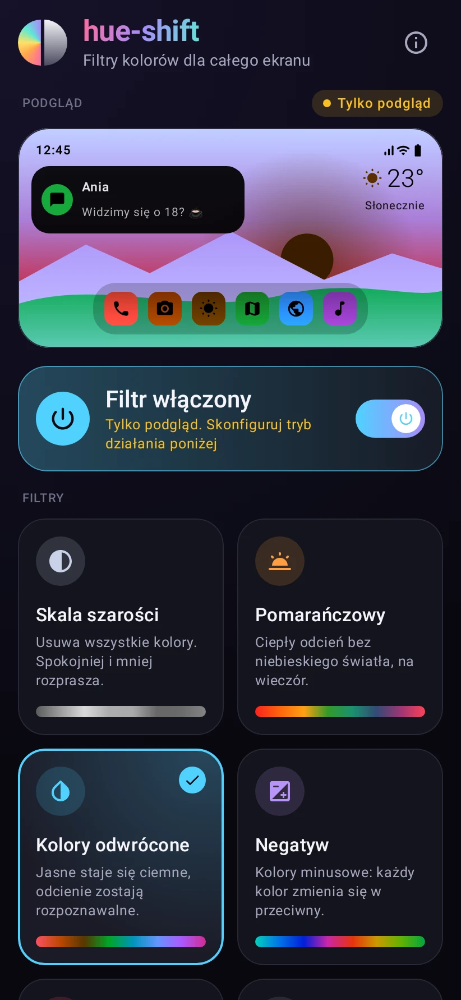
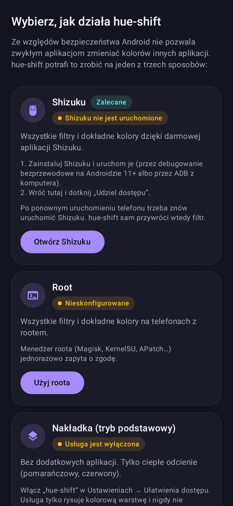

<p align="center">
  
</p>

<p align="center">
  <b>🇵🇱 Polski</b> &nbsp;·&nbsp; <a href="README.en.md">🇬🇧 English</a>
</p>

<p align="center">
  <a href="https://github.com/vSake-clean/hue-shift/actions/workflows/build.yml"></a>
  
  
  <a href="LICENSE"></a>
</p>

**hue-shift** to otwartoźródłowa aplikacja na Androida, która zmienia kolory **całego ekranu**: wszystkich aplikacji, paska stanu i powiadomień. Wybierasz filtr, na przykład skalę szarości, i cały telefon od razu robi się szary. Jeden przełącznik przywraca normalne kolory.

## Spis treści

- [Funkcje](#funkcje)
- [Zrzuty ekranu](#zrzuty-ekranu)
- [Filtry](#filtry)
- [Jak to działa?](#jak-to-działa)
- [Instalacja](#instalacja)
- [Konfiguracja (jednorazowo)](#konfiguracja-jednorazowo)
- [Jak używać](#jak-używać)
- [Pytania i ograniczenia](#pytania-i-ograniczenia)
- [Budowanie ze źródeł](#budowanie-ze-źródeł)
- [Dodawanie nowego filtra](#dodawanie-nowego-filtra)
- [Struktura projektu](#struktura-projektu)
- [Prywatność](#prywatność)
- [Licencja](#licencja)

## Funkcje

- 🎨 **6 filtrów:** skala szarości, pomarańczowy, kolory odwrócone, negatyw (kolory minusowe), skala czerwoności oraz wyłączony.
- 🎚️ **Regulacja intensywności** tam, gdzie ma to sens (szarość, pomarańczowy, czerwień).
- 👀 **Podgląd na żywo** na górze ekranu: od razu widać, jak będzie wyglądał telefon.
- ✨ **Płynne animacje**, także przy zmianie kolorów całego ekranu.
- ⚡ **Szybkie przełączanie bez otwierania aplikacji:** kafelek w szybkich ustawieniach, widżet na ekran główny i skrót z ikony aplikacji.
- 💾 **Zapamiętuje** ostatni filtr i jego intensywność, a po restarcie telefonu sam przywraca filtr.
- 🌙 **Ciemny, nowoczesny wygląd** (Material 3, Jetpack Compose) z dużymi, czytelnymi kartami.
- 🔒 **Bez reklam, bez śledzenia i bez dostępu do internetu.**
- 🌍 Język polski i angielski.
- 🧩 **Łatwe dodawanie nowych filtrów**: jeden wpis w kodzie.

## Zrzuty ekranu

<table>
  <tr>
    <td align="center"><br><sub>Ekran główny</sub></td>
    <td align="center"><br><sub>Skala szarości</sub></td>
    <td align="center"><br><sub>Pomarańczowy, 70%</sub></td>
    <td align="center"><br><sub>Negatyw</sub></td>
  </tr>
  <tr>
    <td align="center"><br><sub>Skala czerwoności</sub></td>
    <td align="center"><br><sub>Podgląd przed konfiguracją</sub></td>
    <td align="center"><br><sub>Wybór trybu działania</sub></td>
    <td></td>
  </tr>
</table>

Zrzuty z włączonym filtrem pokazują ekran tak, jak widać go na telefonie: filtr obejmuje cały obraz, łącznie z samą aplikacją.

## Filtry

| Filtr | Co robi | Intensywność | Tryb podstawowy |
|---|---|:---:|:---:|
| **Skala szarości** | Usuwa wszystkie kolory, zostaje tylko jasność. Telefon mniej przyciąga uwagę. | ✅ | – |
| **Pomarańczowy** | Ciepły odcień bez niebieskiego światła, na wieczór. | ✅ | ✅ |
| **Kolory odwrócone** | Odwraca jasność (jasne tło staje się ciemne), ale zachowuje odcienie, jak systemowe „Odwrócenie kolorów” w Androidzie. | – | – |
| **Negatyw** | Kolory minusowe: każdy kolor zmienia się w przeciwny, jak na negatywie zdjęcia (czerwony → turkusowy). | – | – |
| **Skala czerwoności** | Jak skala szarości, ale w odcieniach czerwieni. Nie oślepia w nocy. | ✅ | ≈ |
| **Wyłączony** | Powrót do normalnych kolorów. | – | – |

✅ obsługiwane, ≈ przybliżenie (patrz [tryby](#jak-to-działa)).

## Jak to działa?

Ze względów bezpieczeństwa Android nie pozwala zwykłym aplikacjom zmieniać kolorów innych aplikacji. hue-shift korzysta z tego samego mechanizmu co systemowe Podświetlenie nocne i tryb skali szarości: **macierzy kolorów w SurfaceFlinger**, czyli w procesie, który składa obraz wyświetlany na ekranie. Macierz działa na cały obraz naraz, więc filtr obejmuje każdą aplikację, pasek stanu, powiadomienia i klawiaturę. Dostęp do niej mają jednak tylko procesy uprzywilejowane, dlatego hue-shift potrzebuje jednego z tych trybów:

| Tryb | Czego wymaga | Filtry | Uwagi |
|---|---|---|---|
| **Shizuku** (zalecany) | darmowej aplikacji [Shizuku](https://shizuku.rikka.app/) | wszystkie, dokładne kolory | po restarcie telefonu trzeba ponownie uruchomić Shizuku |
| **Root** | Magisk, KernelSU, APatch… | wszystkie, dokładne kolory | filtr wraca sam po każdym restarcie |
| **Funkcje systemu** | jednorazowego pozwolenia przez Shizuku albo ADB | skala szarości, kolory odwrócone | wbudowane funkcje Androida; potem działa bez Shizuku, także po restarcie |
| **Nakładka** (tryb podstawowy) | włączenia usługi ułatwień dostępu | pomarańczowy, czerwony (≈) | bez dodatkowych aplikacji, ale tylko zabarwia ekran |

hue-shift sam wybiera najlepszy gotowy tryb; w ustawieniach trybów można wskazać inny. Zanim skonfigurujesz którykolwiek tryb, filtry działają w podglądzie, więc możesz je spokojnie obejrzeć.

## Instalacja

1. Pobierz plik APK z zakładki [Releases](https://github.com/vSake-clean/hue-shift/releases) (albo najnowszy build z zakładki [Actions](https://github.com/vSake-clean/hue-shift/actions/workflows/build.yml), artefakt `hue-shift-debug-apk`).
2. Otwórz go na telefonie i zezwól na instalację z tego źródła.

Wymagany jest Android 8.0 lub nowszy. Możesz też [zbudować aplikację samodzielnie](#budowanie-ze-źródeł).

## Konfiguracja (jednorazowo)

W aplikacji przewiń do sekcji **Sposób działania** i dotknij **Konfiguruj**.

### Tryb Shizuku (zalecany)

[Shizuku](https://shizuku.rikka.app/) pozwala aplikacjom korzystać z uprawnień ADB bez roota.

1. Zainstaluj Shizuku z [Google Play](https://play.google.com/store/apps/details?id=moe.shizuku.privileged.api) lub z [GitHuba](https://github.com/RikkaApps/Shizuku/releases) (przycisk **Pobierz Shizuku** w hue-shift).
2. Uruchom usługę Shizuku w jeden ze sposobów:
   - **Android 11 i nowszy, bez komputera:** włącz Opcje programisty (Ustawienia → Informacje o telefonie → 7 razy stuknij „Numer kompilacji”), a potem w Shizuku wybierz uruchomienie przez **debugowanie bezprzewodowe** i sparuj urządzenie kodem, zgodnie z instrukcją w aplikacji.
   - **Z komputera:** włącz debugowanie USB, podłącz telefon i wykonaj polecenie `adb`, które Shizuku wyświetla w sekcji uruchamiania przez ADB.
   - **Z rootem:** w Shizuku wybierz uruchomienie z rootem.
3. Wróć do hue-shift i dotknij **Udziel dostępu**, a następnie zaakceptuj okno Shizuku.

Gotowe. Po ponownym uruchomieniu telefonu (bez roota) trzeba znów uruchomić Shizuku; hue-shift sam przywróci wtedy ostatni filtr.

### Tryb „Funkcje systemu”

Ten tryb włącza wbudowaną w Androida skalę szarości i odwrócenie kolorów. Przydaje się na telefonach, na których system nie pozwala Shizuku zmieniać macierzy kolorów (np. Xiaomi z HyperOS), i gdy nie chcesz uruchamiać Shizuku po każdym restarcie.

1. Uruchom Shizuku i udziel hue-shift dostępu, jak w trybie Shizuku.
2. W hue-shift dotknij **Nadaj przez Shizuku** w karcie **Funkcje systemu**. Możesz też wykonać na komputerze:
   ```
   adb shell pm grant io.github.vsakeclean.hueshift android.permission.WRITE_SECURE_SETTINGS
   ```

Pozwolenie zostaje na stałe. Od tej chwili skala szarości i kolory odwrócone działają bez Shizuku, a system pamięta je także po restarcie telefonu. Intensywności nie da się w tym trybie regulować.

### Tryb root

Dotknij **Użyj roota** i zatwierdź prośbę menedżera roota. Filtr jest przywracany automatycznie po każdym restarcie telefonu.

### Tryb nakładki (podstawowy)

1. Dotknij **Otwórz ułatwienia dostępu** i włącz usługę **hue-shift (tryb podstawowy)**.
2. Jeżeli przełącznik jest wyszarzony (Android 13 i nowszy, aplikacje zainstalowane z pliku APK), otwórz **Informacje o aplikacji** → menu ⋮ → **Zezwól na ustawienia z ograniczeniami** i spróbuj ponownie.

Usługa tylko rysuje półprzezroczystą warstwę koloru nad ekranem. Nie odczytuje zawartości ekranu, nie obserwuje Twoich działań i nie zbiera żadnych danych. Ten tryb potrafi wyłącznie zabarwić ekran, dlatego obsługuje tylko filtry pomarańczowy i czerwony (ten drugi jako przybliżenie).

## Jak używać

- **Dotknij karty filtra**: cały ekran płynnie zmieni kolory, a podgląd na górze pokaże efekt.
- **Suwak „Intensywność”** pojawia się przy filtrach, w których ma to sens.
- **Duży przełącznik** włącza i wyłącza ostatnio wybrany filtr. Karta **Wyłączony** przywraca normalne kolory.
- Wybrany filtr i intensywność są zapamiętywane.

### Szybkie przełączanie bez otwierania aplikacji

- **Kafelek w szybkich ustawieniach:** rozwiń panel szybkich ustawień, dotknij ✏️ (edytuj) i przeciągnij kafelek **hue-shift** na listę. Dotknięcie włącza lub wyłącza filtr, przytrzymanie otwiera aplikację.
- **Widżet:** przytrzymaj puste miejsce na ekranie głównym → Widżety → **Przełącznik hue-shift**.
- **Skrót:** przytrzymaj ikonę aplikacji i wybierz **Przełącz filtr** (skrót pojawia się po pierwszym uruchomieniu aplikacji).

## Pytania i ograniczenia

**Czy to bezpieczne?**
Tak. hue-shift zmienia wyłącznie macierz kolorów, czyli to samo, co robi Android przy Podświetleniu nocnym. Wyłączenie filtra albo restart telefonu przywraca normalne kolory. Aplikacja nie ma uprawnienia do internetu.

**Podświetlenie nocne, odwrócenie kolorów i korekcja kolorów**
Te funkcje systemu korzystają z tej samej macierzy kolorów. Gdy filtr hue-shift jest włączony, ma pierwszeństwo, a hue-shift przywraca go, jeśli system go nadpisze. Jeśli po wyłączeniu filtra Podświetlenie nocne nie wróciło, wyłącz je i włącz ponownie.

**Zrzuty ekranu**
W trybach Shizuku i root zrzuty ekranu nie zawierają filtra (tak samo jak przy Podświetleniu nocnym). W trybie nakładki go zawierają.

**Restart telefonu**
Macierz kolorów jest kasowana przy każdym restarcie. Z rootem hue-shift przywraca filtr od razu, a w trybie Shizuku zaraz po ponownym uruchomieniu Shizuku.

**Wydajność i bateria**
Na większości telefonów macierz kolorów nakłada sprzęt wyświetlacza, więc filtr praktycznie nie wpływa na baterię. Na urządzeniach bez takiej obsługi system składa obraz na GPU, co może nieco zwiększyć zużycie energii.

**Xiaomi, Redmi, POCO (HyperOS / MIUI)**
W Opcjach programisty włącz także **Debugowanie USB (Ustawienia bezpieczeństwa)**. Bez tego Shizuku pokaże komunikat „Uprawnienia adb są ograniczone” i nie przyzna dostępu. Na części telefonów z HyperOS system i tak nie pozwala Shizuku zmieniać macierzy kolorów (szczegóły błędu: „Operation not permitted”). Wtedy skorzystaj z trybu [„Funkcje systemu”](#tryb-funkcje-systemu) dla skali szarości i odwróconych kolorów oraz z nakładki dla pomarańczowego i czerwonego. Negatywu nie da się wtedy włączyć.

**Nie działa na moim telefonie**
Niektórzy producenci modyfikują sposób wyświetlania obrazu. Jeżeli filtr się nie pojawia, [zgłoś problem](https://github.com/vSake-clean/hue-shift/issues) i podaj model telefonu, wersję Androida i używany tryb.

## Budowanie ze źródeł

Wymagania: JDK 17 lub nowszy oraz Android SDK z platformą 36 (najłatwiej przez Android Studio).

```bash
git clone https://github.com/vSake-clean/hue-shift.git
cd hue-shift
./gradlew assembleDebug        # APK: app/build/outputs/apk/debug/
./gradlew testDebugUnitTest    # testy jednostkowe
```

Wersja release powstaje poleceniem `./gradlew assembleRelease`. Aby podpisać ją własnym kluczem, ustaw zmienne środowiskowe `HUESHIFT_KEYSTORE_PATH`, `HUESHIFT_KEYSTORE_PASSWORD`, `HUESHIFT_KEY_ALIAS` i `HUESHIFT_KEY_PASSWORD`; bez nich APK zostanie podpisany kluczem debug. Nowe wydanie z APK w zakładce Releases publikuje workflow **Release**: wypchnij tag, np. `v1.0.0`, albo uruchom go ręcznie (Actions → Release → Run workflow) i wpisz numer wersji. Workflow użyje Twojego klucza, jeśli dodasz te same wartości jako sekrety repozytorium (klucz jako `HUESHIFT_KEYSTORE_BASE64`).

Obrazy w tym pliku generuje test: `./gradlew testDebugUnitTest -Phueshift.screenshots`.

## Dodawanie nowego filtra

Każdy filtr to jedna definicja w pliku [`Filters.kt`](app/src/main/java/io/github/vsakeclean/hueshift/filter/Filters.kt): macierz kolorów zależna od intensywności oraz, opcjonalnie, przybliżenie dla trybu nakładki. Przykład, sepia:

```kotlin
val Sepia = HueFilter(
    id = "sepia",
    title = R.string.filter_sepia,
    description = R.string.filter_sepia_description,
    icon = { Icons.Rounded.Photo },
    accent = 0xFFC8A27A,
    supportsIntensity = true,
    transform = { t -> ColorTransform.Identity.lerp(ColorTransform.luminance(1.07f, 0.74f, 0.43f), t) },
)
```

Następnie dodaj `Sepia` do listy `Filters.all`, a teksty `filter_sepia` i `filter_sepia_description` do `values/strings.xml` oraz `values-pl/strings.xml`. Karta, podgląd, suwak intensywności, kafelek i widżet zaczną działać od razu. Ta sama macierz steruje podglądem i filtrem na całym ekranie, więc oba zawsze wyglądają tak samo.

## Struktura projektu

```
app/src/main/java/io/github/vsakeclean/hueshift/
├── filter/     # matematyka kolorów i definicje filtrów
├── engine/     # tryby Shizuku, root i nakładka: sposoby zmiany kolorów ekranu
├── core/       # FilterController: stan, wybór trybu i płynne przejścia
├── settings/   # zapisywanie ustawień (DataStore)
├── quick/      # kafelek, widżet, skrót i przywracanie po restarcie
└── ui/         # interfejs w Jetpack Compose
```

Zgłoszenia błędów, pomysły i pull requesty są mile widziane.

## Prywatność

hue-shift nie ma uprawnienia do internetu, nie zbiera żadnych danych i nie zawiera reklam ani bibliotek analitycznych. Ustawienia są przechowywane wyłącznie na telefonie.

## Licencja

Projekt jest udostępniony na licencji [MIT](LICENSE).
